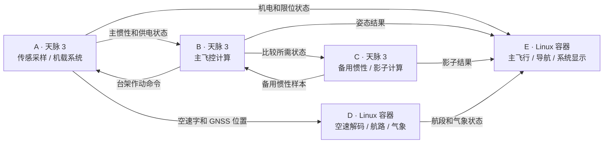

# 五板混合航电台架架构

台架把采集与机电、主飞控、备用计算、导航气象和座舱分到五块逻辑板。当前软件在 Linux 上用同一套 C 服务和 DDS 数据路径贯通。目标分配由配置中的 `target_services` 记录，可用 Windows 的静态规划器导出每项服务的目标板和运行方式。

| 板卡 | 目标系统与资源起点 | 负责什么 |
|---|---|---|
| A · 采集与机电 | 天脉 3 容器版。4 核级 SoC、2–4 GiB RAM，预留采集接口、定时器、机电 I/O 与以太网 | 主惯性和大气采样用原生 C 任务。供电、液压、燃油、起落架状态整理用 C 容器。实验时这里还接合成飞机和机电替身。 |
| B · 主飞控 | 天脉 3 容器版。2–4 核级 SoC、约 2 GiB RAM，预留独立的定时与板间链路 | 姿态选择、模式、操纵参考、反馈计算和状态检查用 C 容器。 |
| C · 备用计算 | 天脉 3 容器版。2–4 核级 SoC、约 2 GiB RAM，预留备用惯性采集接口 | 备用惯性采样用原生 C 任务。备用计算用 C 容器，发送比较所需的结果。 |
| D · 导航和气象 | Linux。4 核级 SoC、4 GiB RAM，预留板间以太网 | C 容器运行空速字解码、导航源比对、航点解算和气象整理。 |
| E · 座舱和观察 | Linux。4–8 核级 SoC、8 GiB RAM，预留图形输出和存储 | C 容器生成主飞行、航路导航与机载系统画面。Python 容器提供本地网页。Genann 气象旁路和只读记录按试验需要启用。 |

这些资源是准备台架时的起点。实际选型根据接口、SDK 可用性和容器开销调整。图中的箭头表示应用之间需要交换哪些数据。板间协议属于后续设计。

**三项原生任务如何分工。** A 板的 `imu_sample`、`airdata_sample` 接近采集接口，C 板的 `imu_backup` 接近备用接口。用这三项做性能对照时，给原生任务和对应容器同一段采样输入，分别记录延迟、抖动和 CPU 开销。保持每路只有一个活动发布方。机载容器复用同一套 C 计算接口。

**DDS 在一块板上怎样用。** 同一块天脉 3 板内的原生任务与容器可按服务依赖交换最新状态。配置生成本板的允许发布、订阅关系，C 适配器核对来源、会话、序号和数据年龄。SDK 负责本机参与者和消息读写。Linux 台架保留 Cyclone DDS 通路用于模拟。 [单板 RTOS DDS](单板RTOS_DDS.md)

**如何看调用链。** 航路图使用“合成飞机运动 → 当地位置 → GNSS 位置替身 → 航点与横向偏差 → 座舱”。起落架信息由“操纵命令与液压 → 机构行程 → 限位开关 → 座舱”产生。两条链使用同一组数据年龄规则。 [机载系统调用关系](机载系统调用关系.md)旁路记录可按服务序号检查哪个消费者使用了哪一份样本。

本机容器入口为 `tools/preview_container.sh`。这套 Linux 联合台架把应用域和显示全部放进容器，给同一次仿真分配独立网络与数据卷。五块目标板的容器和原生任务分配可单独导出。
